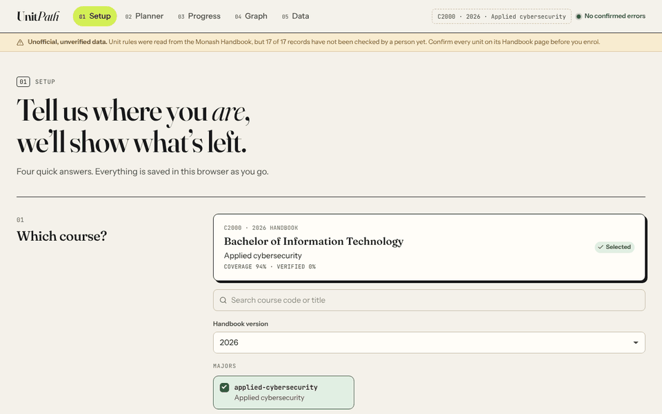

# UnitPath

An unofficial degree planner for Monash students: it checks course rules, explains prerequisites, and suggests a term-by-term route.
**Live demo:** [flamingoff.github.io/unitpath](https://flamingoff.github.io/unitpath/) · no account, no tracking, your plan stays in your browser.

[](https://github.com/FLAMINGOFF/unitpath/actions/workflows/ci.yml)  



> **Data status:** Two 2026 courses were read from their [Monash Handbook 2026](https://handbook.monash.edu/) pages: C2000 Bachelor of Information Technology (Applied cybersecurity major, plus eleven FIT electives) and C2001 Bachelor of Computer Science (all four specialisations). Every record links its source and is still marked unverified until a person checks it ([checklist](docs/VERIFY.md)). Unknown rules, such as the teaching periods of units not offered in 2026, are never treated as met.

## Features

- Build a six-term plan, move units by drag or keyboard-friendly menus, and see confirmed issues on the board.
- Inspect degree progress in completed/enrolled and including-planned views.
- Explore a unit's full prerequisite result tree and its official Handbook source.
- Preview deterministic, constraint-aware scheduling suggestions before applying them.
- Keep plans in local storage, with validated JSON import/export and compressed share links.
- A first-visit guide walks through Setup, Planner, Progress, Graph and Data, and can be reopened from **Guide** in the top bar.

## Deployment

Pushing to `main` runs CI; when CI passes and the repository is public, the Deploy Pages workflow publishes `apps/web/dist` to GitHub Pages. The workflow can also be run by hand.

## Run locally

Requires Node.js 24 and pnpm 11.

```bash
pnpm install --frozen-lockfile
pnpm data:check
pnpm dev
```

Open the local URL printed by Vite. All plan data stays in the browser. `pnpm build` creates a static site in `apps/web/dist`.

Quality gates:

```bash
pnpm lint
pnpm typecheck
pnpm test:coverage
pnpm test:e2e
```

Playwright needs a browser: run `pnpm exec playwright install chromium` once, use an installed Chrome with `UNITPATH_SYSTEM_CHROME=1 pnpm test:e2e`, or point `UNITPATH_CHROMIUM_PATH` at a Chromium binary. Lighthouse accessibility audits of the production build on 25 November 2026 scored 100 on Setup, Planner, Progress, Graph and Data.

The engine has no React, DOM, or network dependency. Its unit tests use fictional `TST` units and exceed 90% statement coverage. A separate test runs the real catalogue and locks in the six-term, zero-error schedule.

## How it works

### Rules are data

Each unit is YAML, and each course year has its own YAML rules. The build validates schema, references, file names, prerequisite cycles, and replacement cycles before producing `catalog.json`. Adding a new course version does not require changing engine code.

```yaml
code: FIT3168
title: IT forensics
creditPoints: 6
offerings:
  - term: S2
    campus: Clayton
requisites:
  prerequisite:
    all:
      - unit: FIT1057
      - any:
          - unit: FIT2173
          - unit: FIT3173
  corequisite: null
  prohibitions:
    - FIT5223
replacedBy: null
source: https://handbook.monash.edu/2026/units/FIT3168
verified: false
```

`TODO` means unreviewed. `null` means a verified absence. See [the data guide](docs/DATA.md) and [verification checklist](docs/VERIFY.md).

### Explanations, not just a red badge

The pure TypeScript engine evaluates recursive `all`, `any`, `atLeast`, unit, credit, level-credit, prefix-credit ("12 points of FIT units") and enrolled-course expressions. It returns a tree with a result and message at every node. A missing prerequisite, a same-term prerequisite, and an unverified requisite are distinct states. The interface can show every unmet branch without short-circuiting.

### Scheduling is a suggestion

The scheduler builds a dependency graph, prioritises long prerequisite chains, and greedily fills eligible terms. It checks offerings, prerequisites, corequisites, prohibitions, and the term limit. It reserves elective slots, which count toward later credit thresholds ("90 points before FIT3047") but never toward degree progress, and it reports units it could not place with a reason. The algorithm is deterministic but heuristic: it does not guarantee the shortest or best plan. On the real 2026 data, an empty applied cybersecurity plan fills six terms with no errors.

## Architecture


`packages/engine` contains schemas, requisite evaluation, progress checks, validation, and scheduling. `apps/web` contains the React interface. There is no backend or school-system integration.

## Privacy and security

UnitPath does not collect plan data, use analytics, or load third-party runtime scripts. Plans stay in `localStorage` until exported or shared by the user. JSON imports and decoded share links have a 1 MB size limit and pass strict Zod validation before replacing the current plan. The static HTML has a same-origin script CSP. GitHub Pages cannot set custom response headers, so this CSP is a meta tag; see [decisions](docs/DECISIONS.md).

## Contributing data

Choose the correct Handbook year and unit page. Add one YAML file per unit under `data/units`, or a course version under `data/courses/CODE/YEAR.yaml`. Keep `source` on every unit and leave unknown fields as `TODO`. Run `pnpm data:check` and the quality gates. The [data guide](docs/DATA.md) describes each format.

## Current limitations

- Unit records are read from the Handbook but not yet checked by a person. See the [verification checklist](docs/VERIFY.md).
- Only C2000 (2026) applied cybersecurity and C2001 (2026) computer science are published so far. Other courses can be added as YAML; see [contributing data](#contributing-data).
- Teaching periods other than S1, S2 and summer, attendance modes, double degrees and Honours are not modelled.
- Industry Based Learning is shown as a pathway, but its placement terms are not scheduled automatically.

## Disclaimer

UnitPath is an unofficial, student-built planning aid and is not affiliated with or endorsed by Monash University. Course rules and unit data may be incomplete or out of date. Always confirm your enrolment against the official Monash Handbook and with your faculty's course advisers.

MIT licensed. See [LICENSE](LICENSE).
