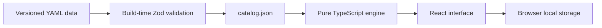

# UnitPath

UnitPath is an unofficial, local-first degree planner for Monash IT students.
It turns course rules into clear progress checks, prerequisite explanations, and term-by-term suggestions.
**Demo:** run locally for now. The [source repository](https://github.com/FLAMINGOFF/unitpath) is private; public publication is pending verification of unit data.

> **Data status:** The 2026 C2000 Applied cybersecurity course structure is seeded from the [official course map](https://www.monash.edu/__data/assets/pdf_file/0014/4150220/2026-C2000-BInfoTech-AppCyber.pdf). All 17 unit records are marked unverified. Their offerings, requisites, prohibitions, and replacement fields are `TODO`. UnitPath will not treat these unknown rules as satisfied. The elective list is also pending.

## Features

- Build a six-term plan, move units by drag or keyboard-friendly menus, and see confirmed issues on the board.
- Inspect degree progress in completed/enrolled and including-planned views.
- Explore a unit's full prerequisite result tree and its official Handbook source.
- Preview deterministic, constraint-aware scheduling suggestions before applying them.
- Keep plans in local storage, with validated JSON import/export and compressed share links.

## Run locally

Requires Node.js 24 and pnpm 11.

```bash
pnpm install --frozen-lockfile
pnpm data:check
pnpm dev
```

Open the local URL printed by Vite. All plan data stays in the browser. `pnpm build` creates a static site in `apps/web/dist`.

Quality gates:

```bash
pnpm lint
pnpm typecheck
pnpm test:coverage
pnpm test:e2e
```

Playwright needs a browser: run `pnpm exec playwright install chromium` once, or use an existing Chrome installation with `UNITPATH_SYSTEM_CHROME=1 pnpm test:e2e`. Local Lighthouse accessibility audits on 25 November 2026 scored 100 for Setup, 96 for Plan, 96 for Progress, 96 for Graph, and 100 for Settings.

The engine has no React, DOM, or network dependency. Its unit tests use fictional `TST` units and currently exceed 90% statement coverage. The real course catalog also passes a build-time smoke check.

## How it works

### Rules are data

Each unit is YAML, and each course year has its own YAML rules. The build validates schema, references, file names, prerequisite cycles, and replacement cycles before producing `catalog.json`. Adding a new course version does not require changing engine code.

```yaml
code: FIT2173
title: Software security
creditPoints: 6
offerings: TODO
requisites:
  prerequisite: TODO
  corequisite: TODO
  prohibitions: TODO
replacedBy: TODO
source: https://handbook.monash.edu/2026/units/FIT2173
verified: false
```

`TODO` means unreviewed. `null` means a verified absence. See [the data guide](docs/DATA.md) and [verification checklist](docs/VERIFY.md).

### Explanations, not just a red badge

The pure TypeScript engine evaluates recursive `all`, `any`, `atLeast`, unit, credit, level-credit, and enrolled-course expressions. It returns a tree with a result and message at every node. A missing prerequisite, a same-term prerequisite, and an unverified requisite are distinct states. The interface can show every unmet branch without short-circuiting.

### Scheduling is a suggestion

The scheduler builds a dependency graph, prioritises long prerequisite chains, and greedily fills eligible terms. It checks offerings, prerequisites, corequisites, prohibitions, and the term limit. It adds explicit elective placeholders and reports units it could not place. The algorithm is deterministic but heuristic: it does not guarantee the shortest or best plan. With the current unverified unit catalog, automatic core placement is intentionally blocked.

## Architecture



`packages/engine` contains schemas, requisite evaluation, progress checks, validation, and scheduling. `apps/web` contains the React interface. There is no backend or school-system integration.

## Privacy and security

UnitPath does not collect plan data, use analytics, or load third-party runtime scripts. Plans stay in `localStorage` until exported or shared by the user. JSON imports and decoded share links have a 1 MB size limit and pass strict Zod validation before replacing the current plan. The static HTML has a same-origin script CSP. GitHub Pages cannot set custom response headers, so this CSP is a meta tag; see [decisions](docs/DECISIONS.md).

## Contributing data

Choose the correct Handbook year and unit page. Add one YAML file per unit under `data/units`, or a course version under `data/courses/CODE/YEAR.yaml`. Keep `source` on every unit and leave unknown fields as `TODO`. Run `pnpm data:check` and the quality gates. The [data guide](docs/DATA.md) describes each format.

## Current limitations

- The unit-level catalog requires Handbook verification, including campus-specific teaching periods. See [verification checklist](docs/VERIFY.md).
- No elective unit list has been chosen. Electives remain labelled slots rather than fabricated unit codes.
- No public GitHub Pages URL or demo GIF is available yet.
- The Pages workflow requires a manual trigger; a push to `main` cannot publish the site.
- The v1 model covers single degrees and Semester 1/2 only. It does not model IBL placement load, summer/winter units, doubles, or Honours.

## Disclaimer

UnitPath is an unofficial, student-built planning aid and is not affiliated with or endorsed by Monash University. Course rules and unit data may be incomplete or out of date. Always confirm your enrolment against the official Monash Handbook and with your faculty's course advisers.

MIT licensed. See [LICENSE](LICENSE).
